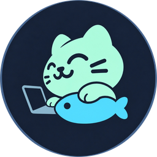
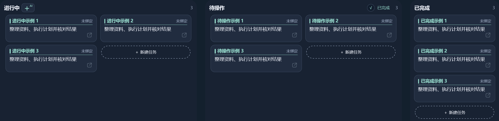

<!-- README_SYNC: source=working-tree; updated=2026-11-27 -->

<p align="center">
  简体中文 · <a href="./README_EN.md">English</a>
</p>

<p align="center">
  
</p>

<h1 align="center">摸鱼台 · MoyuDesk</h1>

<p align="center">
  面向多任务并行与多 AI 会话协作的 Windows 桌面任务看板：常驻系统托盘与悬浮球，不占任务栏，用纯被动本地读取把任务阶段与 Codex / DSH / Claude Code 会话进度对齐。
</p>

<p align="center">
  如果摸鱼台帮你在多个 AI 会话和待办之间少切了几次窗口，欢迎到 <a href="https://github.com/Derp-zh/MoyuDesk">GitHub 仓库点亮 Star</a> 收藏，也让更多同类用户更容易发现它。
</p>

<p align="center">
  <a href="https://github.com/Derp-zh/MoyuDesk/stargazers"></a>
  <a href="https://github.com/Derp-zh/MoyuDesk/releases/latest"></a>
  <a href="https://github.com/Derp-zh/MoyuDesk/releases/latest"></a>
  <a href="./docs/ARCHITECTURE.md"></a>
  <a href="https://github.com/Derp-zh/MoyuDesk/issues"></a>
  <a href="https://github.com/Derp-zh/MoyuDesk/commits"></a>
</p>

<p align="center">
  <a href="https://github.com/Derp-zh/MoyuDesk/releases/latest"><strong>下载 Windows 便携版</strong></a> ·
  <a href="./CHANGELOG.md">版本记录</a> ·
  <a href="./docs/STATUS.md">当前状态与边界</a> ·
  <a href="https://github.com/Derp-zh/MoyuDesk/issues">反馈问题</a>
</p>

---

> **当前目标版本：0.9.56** — 换装正式猫咪摸鱼图标、新增独立“外观”设置（深夜 / 白天 / 跟随系统与多套配色实时切换）、确保零底部任务栏占用，并在 0.9.54–0.9.55 基础上完成待操作列常驻鼠标穿透与滚轮翻阅、定时提醒原位提醒与整点对齐、长文本卡片首屏提速、纯 TSF 输入法（微信输入法等）单按 `Ctrl` 切中英文支持与全程序高对比圆角控件升级。

## 为什么做摸鱼台

当你同时推进好几件事、手里开着好几个 AI 编程会话时，最耗神的往往不是干活本身，而是**来回切窗口确认“谁卡住了、谁做完了、我刚才想到一半的事写哪了”**。

| 日常痛点 | 传统手工做法 | 使用摸鱼台（MoyuDesk） |
| --- | --- | --- |
| 多 AI 会话并行盯进度 | 挨个点开客户端和标签页翻看哪个会话在等回答/批准 | 任务按阶段绑定对应会话，AI 等待回答、批准或待验收时自动移入“待操作”，点一下直达原会话 |
| 桌面留待办又怕遮挡操作 | 开着便签或网页待办，占任务栏还老被误点挡视线 | **不占底部任务栏**；可把“待操作”列钉成半透明常驻窗口，点击 100% 穿透到底层软件，悬停仍可滚轮上下翻看 |
| 临时提醒打乱任务排序 | 到点强制弹窗或把暂搁置任务挪乱 | 定时提醒新建自动对齐当前日期与下一个整点，到期**留在原位亮红点**，悬停紧凑气泡一键关闭 |
| 本地隐私与零运维升级 | 依赖账号云同步或每次手删旧包断自启 | 全部数据留在本地，零自建服务器；支持便携包固定目录原子升级/回滚，并直连 GitHub Releases 检查更新与校验 SHA256 |

<p align="center">
  
  <br />
  <sub>专注模式（“进行中 / 待操作”双宽面板 + 右侧“已完成”窄槽）布局预览</sub>
</p>

---

## 核心特性

### 1. 不占任务栏的轻量桌面看板
- **纯托盘 + 悬浮球 + 快捷键**：绝不占用 Windows 底部任务栏，通过系统托盘、桌面悬浮球或全局快捷键（默认 `Ctrl+~`）随时呼出与收起。悬浮球支持左右桌面边缘吸附自动隐藏，也可在托盘中彻底隐藏。
- **六列自由布局 & 专注模式**：内置六个独立可移动/缩放的毛玻璃列表窗口（**灵感库、完善中、进行中、待操作、暂搁置、已完成**），支持自定义列表、拖卡排序、按住 `Shift` 拖拽左下角范围按钮整体平移最大范围，以及一键切换“两宽一窄”专注模式。
- **全屏游戏与输入法友好**：支持全屏/无边框游戏中点击画面外部正常收起；内置国内外主流输入法（微软拼音、微信输入法 WeType、豆包、智谱 AI、搜狗、讯飞、百度、QQ、手心、小狼毫/Rime、PIME、Google 日语、Mozc、ATOK）选词框点击免疫，并修复了纯 TSF 输入法（微信输入法等）在玻璃子窗中单按 `Ctrl` 切换中英文失效的问题。

### 2. “待操作”列常驻 + 鼠标穿透 + 悬停滚轮
- 仅在内置 **待操作** 列标题栏提供圆形图钉按钮：点击后该列半透明置顶常驻桌面（默认 `70%` 透明，设置“窗口与列表”页可单独调节滑块），切到其他应用或点击窗口外时保持常驻不收起。
- **点击全穿透，悬停可滚动**：常驻态下整列对鼠标点击 100% 穿透到底层软件或游戏，只有图钉按钮本身可点击解除；鼠标悬停在有溢出内容的常驻列上时，仍可直接滚动滚轮平滑上下翻看任务（无溢出时自动放行给底层应用）。
- **快捷键状态记忆**：按全局快捷键隐藏后再按快捷键唤起，严格保持常驻 + 半透明 + 鼠标穿透状态。

### 3. 全新“外观”分页：深夜、白天、跟随系统与多配色
- 独立 **外观** 设置分页提供三大主模式：
  - **深夜模式（默认）**：经典的**青 + 深色**毛玻璃配色；
  - **白天模式**：护眼清爽的浅色高对比配色；
  - **跟随系统**：自动监听 Windows 深浅色设置并实时切换。
- 下方附带多套深色与浅色预设配色方案，点击即刻在所有列表、编辑窗、设置页、悬浮球与菜单间实时生效。
- 搭配列表、浮窗、悬浮球与常驻列独立透明度调节；将任意透明度调至 `0%`（完全不透明）时自动跳过桌面实时模糊采样，进一步降低显卡开销。全程序采用统一圆角矩形/正圆按钮与高对比度勾选/单选控件。

### 4. 分阶段任务编辑、长文本提速与原位定时提醒
- **分阶段管理**：单个任务可拆分多个阶段（仅 **运行中 / 未运行** 两种状态，无自动完成）；阶段名称整颗胶囊即单一输入框，支持上下拖拽排序、新建阶段默认状态三选一并自动聚焦、首尾行方向键跳至最开头/最末尾与暗色圆角右键菜单。
- **长文本秒开与自适应省略**：多列表阶段详情默认按总行数等比例省略，点击末尾 `[…]` / `[▴]` 气泡展开或收起并持久化记住状态；编辑窗针对超长多阶段文本做了首屏视口轻量化与按需水合，大幅降低打开与拖拽卡顿。
- **多草稿堆叠 & 撤销归档**：支持同时暂存多份未提交新建草稿并抽牌切换、重启自动恢复；支持本次运行最近 20 步正式修改撤销/恢复，以及手动/自动按天归档与恢复。
- **原位定时提醒**：支持一次性、每天、每周提醒；新建或开启提醒时自动对齐**当前日期与下一个小时整点**，采用小时与分钟独立滚动列表即点即生效。提醒到期后**卡片留在原列表原位不动**，仅在原位亮起红点并通知，悬停红点弹出紧凑两段式气泡（提醒时间 + 关闭提醒按钮）。

### 5. 分阶段被动 AI 会话监听与拖放绑定
- 每个阶段可独立关联一个外部 AI 会话（支持同一任务不同阶段绑定不同会话）。
- **仅在内置“进行中 ↔ 待操作”间自动双向流转**：AI 等待回答、批准、失败/中断或正常执行结束待验收时推入“待操作”；实际恢复后续执行时回到“进行中”；**绝不自动标为“已完成”**。
- **便捷交互**：支持从卡片或编辑窗直接拖动到原客户端会话绑定、拖动到“绑定会话专属窗口”的“解除绑定”区松手解绑、左键点击卡片右下角一键跳转回原会话（跳转成功后联动消除绑定同一会话的所有阶段橙红提醒；未绑定卡片自动隐藏跳转按钮）。

---

## 快速开始

适用于 **Windows 10（2004 及以上）与 Windows 11（64 位）**。发布包已内置 `.NET 8` 运行时，无需单独安装环境。

### 方式一：下载便携版直接运行或固定目录安装（推荐）

1. 打开 [最新 Release 页面](https://github.com/Derp-zh/MoyuDesk/releases/latest)，下载 `MoyuDesk-*-portable-win-x64.zip`（可选同时下载校验文件核对 SHA256）。
2. 解压完整目录后，任选以下一种方式启动：
   - **绿色免安装即用**：直接运行解压目录中的 `MoyuDesk.exe`。
   - **固定目录安装与后续平滑升级（推荐，免管理员权限）**：双击便携包内的 `安装或升级摸鱼台.cmd`，或运行：

```powershell
powershell -NoProfile -ExecutionPolicy Bypass -File .\scripts\install.ps1
```

安装脚本会将程序安装至固定用户目录 `%LOCALAPPDATA%\MoyuDesk\app`，自动维护桌面/开始菜单快捷方式与开机自启路径（彻底避免更新删旧文件夹导致自启断链），升级前自动将上一版本完整备份至 `%LOCALAPPDATA%\MoyuDesk\.rollback-<version>`，且**绝不修改**正式用户数据目录 `%LOCALAPPDATA%\InstantTaskboard`。

- **程序内免服务器检查更新**：后续可在 **设置 → 常规 → 版本与更新** 中直接点击“检查新版本”，直连 GitHub Releases API 查询新版、下载便携包并强校验 `SHA256SUMS.txt` 后自动拉起平滑升级。
- **一键回退上一版本 / 卸载（保留用户数据）**：

```powershell
# Roll back to the previous installed version (user data stays untouched)
powershell -NoProfile -ExecutionPolicy Bypass -File "$env:LOCALAPPDATA\MoyuDesk\app\scripts\rollback.ps1"

# Uninstall program binaries and shortcuts only (keeps %LOCALAPPDATA%\InstantTaskboard)
powershell -NoProfile -ExecutionPolicy Bypass -File "$env:LOCALAPPDATA\MoyuDesk\app\scripts\uninstall.ps1"
```

### 方式二：从源码编译与运行离屏检查

需要安装 `.NET 8 SDK`（Windows x64）与 `Python 3`：

```powershell
# Static module ownership and retired-code check
python tools/check_project.py

# Build desktop app
dotnet build src/Taskboard.Desktop/Taskboard.Desktop.csproj

# Run offscreen core tests in an isolated data directory
dotnet run --project tests/Taskboard.Checks -- --data-dir test-output/checks-run

# Run offscreen binding and UI regression tests
dotnet run --project tests/Taskboard.Binding.Tests -- --data-dir test-output/binding-run

# Build a self-contained Windows x64 portable package into a fresh folder
powershell -ExecutionPolicy Bypass -File tools/Build-Portable.ps1 -Output release/MoyuDesk-local
```

> 隔离测试时可通过 `--data-dir <目录>` 启动 `MoyuDesk.exe`，与 `%LOCALAPPDATA%\InstantTaskboard` 正式数据完全隔离。

---

## AI 平台接入现状与透明边界

摸鱼台坚持**只观察、不打扰、不代操作**原则，各平台实际状态如实列明如下（详细进度见 [当前状态与边界](./docs/STATUS.md)）：

| 平台 / 模块 | 当前状态 | 工作机制与边界说明 |
| --- | --- | --- |
| **Codex** | 已实现并日常稳定使用 | 纯被动只读本机 SQLite 目录、行为日志与前台只读原生请求控件；**不连管道/端口、不启 CLI、不发消息/代答/批准**；支持拖动绑定与一键跳转会话（[规则详情](./docs/current/C01-Codex接入.md)） |
| **DSH** | 已接入 | 只读本机原生 v4 压缩日志（优先复用 DSH 自带运行时）；支持拖动绑定与一键跳转会话（[规则详情](./docs/current/C02-DSH接入探索.md)） |
| **Claude Code** | 代码已合入，待原客户端真机实测 | 支持原生 Hook 事件写入与桌面 Code 会话目录稳定 ID 映射；暂缺已登录客户端完整实机验证，暂不支持一键跳转会话（[规则详情](./docs/current/C03-Claude监听.md)） |
| **WorkBuddy / 豆包** | 仅完成可行性调研 | 尚未开发产品接入代码（[调研记录](./docs/research/20261117-workbuddy-doubao-listeners.md)） |
| **飞书同步** | 暂未实现（界面已隐藏） | 需后续专项确认目标表与同步边界后再开发（[调研记录](./docs/research/feishu-sync.md)） |
| **Windows 通知提示音替换** | 已实现（默认关闭） | 独立于 AI 监听，可按应用替换通知提示音并支持试听，不驱动任务移列；实际捕获与原系统音恢复需按目标应用单独验证（[规则详情](./docs/current/N01-通知监听.md)） |

**已知使用边界**：
- AI 平台标签也可作为普通任务分类使用，给任务打上某平台标签并不代表已连接该平台。
- 复杂场景（如 Codex 全部批准类型并发、DSH 多屏混合 DPI 长期运行、部分杀软/反作弊高权限全屏游戏屏蔽非提权外点事件等）仍在持续打磨，详情见 [当前状态与边界](./docs/STATUS.md)。

---

## 架构、数据位置与隐私

项目分为无界面核心库 `src/Taskboard.Core` 与 Windows 桌面端 `src/Taskboard.Desktop`（WPF + WinForms + Direct2D/D3D11 Composition + UIAutomation），共 14 个显式归属模块（通过 `Modules/*.props` 与 `python tools/check_project.py` 强制校验）：

- **代码架构与测试工具**：[docs/ARCHITECTURE.md](./docs/ARCHITECTURE.md)
- **现行功能模块规则（M01–M12 / C01–C03 / N01 / SURFACE）**：[docs/current/README.md](./docs/current/README.md)
- **共享表面（毛玻璃、主题、命中、动画、输入）修改影响表**：[docs/architecture/SHARED-CODE.md](./docs/architecture/SHARED-CODE.md)

**数据存储与隐私边界**：
- 所有任务、阶段、草稿与偏好设置均保存在本机，**无账号体系、无云端遥测、不上传你的任务文本或 AI 聊天正文**。
- 默认数据目录：`%LOCALAPPDATA%\InstantTaskboard\data`（任务与草稿）、`%LOCALAPPDATA%\InstantTaskboard\config`（偏好与布局），均可在设置中自定义；程序文件与数据严格分离。
- 设置中的 **“配置备份”** 仅导出设置、布局与选项定义，**不包含任务内容和草稿**；换电脑迁移时请一并备份实际的任务数据目录。
- 本程序唯一的可选外网请求是你在设置中主动点击“检查新版本”时访问 GitHub Releases 公开接口获取最新版本信息与安装包。

---

## 反馈与许可证说明

- 如果摸鱼台对你的日常工作有帮助，欢迎在 [项目首页](https://github.com/Derp-zh/MoyuDesk) 点一个 **Star**，或在 [Releases](https://github.com/Derp-zh/MoyuDesk/releases) 订阅新版本发布；遇到 Bug 或有顺手的改进建议，欢迎直接提交 [Issue](https://github.com/Derp-zh/MoyuDesk/issues)。
- **许可证说明**：本仓库当前**尚未添加 `LICENSE` 文件**，源码的使用、修改与再分发授权条款尚未声明；第三方依赖声明见 [THIRD-PARTY-NOTICES.txt](./docs/THIRD-PARTY-NOTICES.txt)。
