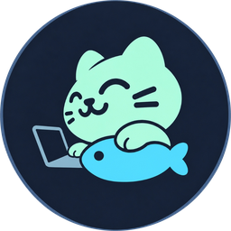
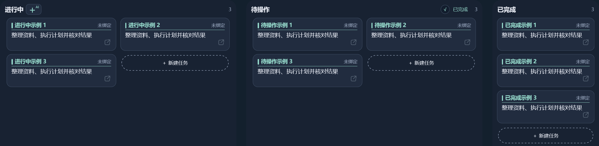

<!-- README_SYNC: source=working-tree; updated=2026-11-27 -->

<p align="center">
  <a href="./README.md">简体中文</a> · English
</p>

<p align="center">
  
</p>

<h1 align="center">MoyuDesk (摸鱼台)</h1>

<p align="center">
  A local-first Windows desktop task board built for parallel work and AI coding sessions—living in the system tray and a floating orb with zero taskbar clutter, passively aligning task stages with Codex, DSH, and Claude Code sessions.
</p>

<p align="center">
  If MoyuDesk saves you from constantly hunting through tabs and AI chat windows, consider <a href="https://github.com/Derp-zh/MoyuDesk">starring the repository</a> to bookmark it and help other desktop AI users find it.
</p>

<p align="center">
  <a href="https://github.com/Derp-zh/MoyuDesk/stargazers"></a>
  <a href="https://github.com/Derp-zh/MoyuDesk/releases/latest"></a>
  <a href="https://github.com/Derp-zh/MoyuDesk/releases/latest"></a>
  <a href="./docs/ARCHITECTURE.md"></a>
  <a href="https://github.com/Derp-zh/MoyuDesk/issues"></a>
  <a href="https://github.com/Derp-zh/MoyuDesk/commits"></a>
</p>

<p align="center">
  <a href="https://github.com/Derp-zh/MoyuDesk/releases/latest"><strong>Download for Windows</strong></a> ·
  <a href="./CHANGELOG.md">Changelog</a> ·
  <a href="./docs/STATUS.md">Status &amp; Boundaries</a> ·
  <a href="https://github.com/Derp-zh/MoyuDesk/issues">Report an Issue</a>
</p>

---

> **Target release: 0.9.56** — ships with the official MoyuDesk mascot icon, a dedicated **Appearance** settings page (Dark / Light / System themes plus live color presets), strict zero-taskbar presence, and builds on 0.9.54–0.9.55 improvements including a click-through pinned Needs Action column with hover scrolling, stay-in-place reminders aligned to the next full hour, faster long-card editor opening, single-`Ctrl` TSF IME switching (e.g., WeType), and high-contrast rounded UI controls.

## Why MoyuDesk

When you run several projects and AI coding sessions at once, the real friction is rarely a single task—it is **switching back and forth to check which agent is waiting for an answer, which run needs review, and where you left your notes**.

| Everyday Friction | Manual Workflow | With MoyuDesk |
| --- | --- | --- |
| Tracking parallel AI sessions | Click through multiple desktop apps and threads to see who stopped | Bind each task stage to a local AI session; waiting questions, approvals, or completed runs automatically move the card to **Needs action** with one-click jump back |
| Keeping todos visible without blocking work | Sticky notes or web boards clutter the taskbar and intercept clicks | **Zero taskbar footprint**; pin **Needs action** as a translucent click-through overlay whose cards still scroll smoothly on mouse-wheel hover |
| Reminders disrupting board layout | Due reminders pop over work or forcibly relocate on-hold items | New reminders default to today + next full hour; due cards **stay right where they are** with an in-place badge and compact hover dismiss bubble |
| Local privacy & painless upgrades | Cloud accounts required, or manual folder replacement breaking startup links | 100% local storage with no backend server; per-user fixed-folder install/upgrade/rollback scripts plus in-app GitHub Releases updater with SHA256 verification |

<p align="center">
  
  <br />
  <sub>Focus Mode preview: two wide columns (In progress / Needs action) paired with a collapsible Done rail</sub>
</p>

---

## Key Capabilities

### 1. Zero-Taskbar Desktop Board & Floating Orb
- **Tray + Floating Orb + Hotkey**: Never creates a Windows taskbar button. Toggle the board anytime from the floating orb, system tray, or global shortcut (`Ctrl+~` by default). The orb supports left/right desktop edge docking with auto-hide and can also be hidden completely from the tray.
- **Six Independent Lists & Focus Mode**: Starts with six individually movable, resizable frosted-glass windows (**Ideas, Refining, In progress, Needs action, On hold, Done**), plus custom lists, drag-and-drop card reordering, `Shift`-drag group repositioning from the bottom-left handle, and a two-wide-one-narrow Focus Mode.
- **Fullscreen Game & IME Friendly**: Collapses cleanly on outside clicks even over fullscreen/borderless games; ignores candidate windows from major IMEs (Microsoft IME, WeType/WeChat Input, Doubao, Zhipu AI, Sogou, iFlytek, Baidu, QQ, ShouXin, Rime/Weasel, PIME, Google Japanese Input, Mozc, ATOK) and bridges `VK_CONTROL` to TSF so single-`Ctrl` language toggling works inside text inputs.

### 2. Pinned Click-Through "Needs Action" Column
- Click the circular pushpin button in the **Needs action** column header to pin it on top of your desktop with configurable translucency (`70%` transparent by default, tuned via a dedicated slider in Settings → Windows).
- **Click-Through + Wheel Scroll**: Every click passes straight through to underlying apps or games except the pushpin button itself (used to unpin). Hovering the pointer over an overflowing pinned list still lets you scroll smoothly with the mouse wheel; when there is nothing to scroll, wheel events pass right through.
- **Hotkey State Memory**: Hiding and re-summoning with the global shortcut preserves the pinned, translucent, click-through state.

### 3. Dedicated Appearance Settings & Live Themes
- Choose from three primary modes in the new **Appearance** settings page:
  - **Dark mode (default)**: signature cyan accent on deep slate glass;
  - **Light mode**: low-glare daylight theme with crisp high-contrast controls;
  - **Follow system**: listens to Windows light/dark theme changes and switches live.
- Additional dark and light color presets live right below for instant live switching across columns, editors, settings, orb, and menus.
- Independent transparency sliders cover lists, floating editors, the orb, and the pinned column; setting any surface to `0%` transparency (fully opaque) automatically bypasses live desktop backdrop blur to save GPU work.

### 4. Multi-Stage Editing, Long-Card Performance & In-Place Reminders
- **Stage-Based Tasks**: Split any task into named stages (strictly **Running** or **Not running**—no auto-completion), edit stage names inside a single unified capsule input, drag to reorder stages, configure the default running state for new stages with automatic focus, use Up/Down on first/last lines to jump to start/end, and use dark rounded context menus.
- **Fast Long-Text Cards**: Multi-list stage descriptions default to proportional line truncation with clickable `[…]` / `[▴]` expand/collapse bubbles whose state persists across sessions; the task editor uses lightweight initial viewport rendering and on-demand hydration to open multi-stage long-text cards quickly.
- **Stacked Drafts, Undo & Archive**: Keep multiple unfinished drafts stacked and switch between them (preserved across restarts), undo/redo the last 20 committed edits per session, and archive/restore completed or on-hold work manually or by age.
- **Stay-in-Place Reminders**: Supports one-time, daily, and weekly schedules. Enabling a reminder defaults to the **current date and next full hour**, using independent scrollable hour and minute lists. When due, **cards stay in their original column** and show a dot badge whose compact hover bubble displays the reminder time and a one-click Dismiss button.

### 5. Passive Per-Stage AI Session Tracking
- Link each stage independently to a local AI session (different stages in one task can track different sessions).
- **Bounded Automatic Movement**: Only built-in **In progress ↔ Needs action** move automatically. Waiting questions, approvals, failures/interrupts, or runs ready for review move the card to **Needs action**; confirmed subsequent execution returns it to **In progress**. MoyuDesk **never marks a task Done automatically**.
- **Drag-to-Bind & One-Click Jump**: Drag directly from a card or editor onto a native client conversation to bind, drop onto the binding picker's Unbind zone to clear, or left-click the card jump button to switch straight to the conversation (successful jump clears the orange-red attention indicator across all stages sharing that session; unbound cards hide the jump button).

---

## Quick Start

Requires **64-bit Windows 10 (version 2004 or later) or Windows 11**. Release archives are self-contained with `.NET 8` bundled—no separate runtime install needed.

### Option 1: Portable Run or Fixed Per-User Install (Recommended)

1. Download `MoyuDesk-*-portable-win-x64.zip` (and optional checksum file) from the [latest GitHub Release](https://github.com/Derp-zh/MoyuDesk/releases/latest).
2. Extract the full archive, then either:
   - **Run portable as-is**: launch `MoyuDesk.exe` directly from the extracted folder.
   - **Install to a fixed user folder for seamless upgrades (no admin rights)**: double-click `安装或升级摸鱼台.cmd`, or run:

```powershell
powershell -NoProfile -ExecutionPolicy Bypass -File .\scripts\install.ps1
```

The installer places binaries in `%LOCALAPPDATA%\MoyuDesk\app`, keeps desktop/Start Menu shortcuts and auto-start pointing to that stable path, backs up the previous version to `%LOCALAPPDATA%\MoyuDesk\.rollback-<version>` before swapping, and **never touches** your task/config data in `%LOCALAPPDATA%\InstantTaskboard`.

- **Zero-server in-app updates**: Open **Settings → General → Version & Updates** to check the public GitHub Releases API, verify `SHA256SUMS.txt`, and run the atomic upgrade flow automatically.
- **Roll back or uninstall (preserving your tasks and settings)**:

```powershell
# Roll back to the previous installed version (user data stays untouched)
powershell -NoProfile -ExecutionPolicy Bypass -File "$env:LOCALAPPDATA\MoyuDesk\app\scripts\rollback.ps1"

# Uninstall program binaries and shortcuts only (keeps %LOCALAPPDATA%\InstantTaskboard)
powershell -NoProfile -ExecutionPolicy Bypass -File "$env:LOCALAPPDATA\MoyuDesk\app\scripts\uninstall.ps1"
```

### Option 2: Build & Run Offscreen Checks from Source

Requires the `.NET 8 SDK` (Windows x64) and `Python 3`:

```powershell
# Static module ownership and retired-code check
python tools/check_project.py

# Build desktop app
dotnet build src/Taskboard.Desktop/Taskboard.Desktop.csproj

# Run offscreen core tests in an isolated data directory
dotnet run --project tests/Taskboard.Checks -- --data-dir test-output/checks-run

# Run offscreen binding and UI regression tests
dotnet run --project tests/Taskboard.Binding.Tests -- --data-dir test-output/binding-run

# Build a self-contained Windows x64 portable package into a fresh folder
powershell -ExecutionPolicy Bypass -File tools/Build-Portable.ps1 -Output release/MoyuDesk-local
```

> Pass `--data-dir <folder>` when testing `MoyuDesk.exe` to stay completely isolated from `%LOCALAPPDATA%\InstantTaskboard`.

---

## AI Platform Support & Honest Boundaries

MoyuDesk is designed to **observe passively without driving or interfering with your AI clients**. Current status and boundaries (see [Status & Boundaries](./docs/STATUS.md)):

| Platform / Module | Current Status | Mechanism & Boundaries |
| --- | --- | --- |
| **Codex** | Implemented & in daily use | Passive read-only access to local SQLite catalog, behavior logs, and foreground read-only native request controls; **no pipes/ports, no CLI spawning, no sending/answering/approving**; supports drag-to-bind and one-click jump ([spec](./docs/current/C01-Codex接入.md)) |
| **DSH** | Implemented | Read-only native v4 compressed log observer (reuses DSH's own runtime first); supports drag-to-bind and one-click jump ([spec](./docs/current/C02-DSH接入探索.md)) |
| **Claude Code** | Merged in code; live client validation pending | Native Hook event ingestion + desktop Code session catalog stable-ID mapping; full live client lifecycle not yet tested due to lack of a logged-in local client; one-click jump not yet supported ([spec](./docs/current/C03-Claude监听.md)) |
| **WorkBuddy / Doubao** | Feasibility research only | No product integration code implemented yet ([research](./docs/research/20261117-workbuddy-doubao-listeners.md)) |
| **Feishu Sync** | Not implemented (UI hidden) | Deferred until target schema and sync rules are finalized ([research](./docs/research/feishu-sync.md)) |
| **Custom Windows Notification Sounds** | Implemented (off by default) | Separate from AI tracking; replaces per-app Windows notification audio with previews and never moves cards; real capture and original-sound restoration should be validated per target app ([spec](./docs/current/N01-通知监听.md)) |

**Known boundaries**:
- AI platform tags can also be used as plain task labels; tagging a card does not imply a live connection to that platform.
- Edge cases such as high-concurrency multi-approval Codex runs, long-running multi-DPI DSH setups, or elevated/anti-cheat fullscreen games blocking non-elevated outside-click hooks remain documented in [Status & Boundaries](./docs/STATUS.md).

---

## Architecture, Local Data & Privacy

The repository separates the headless engine (`src/Taskboard.Core`) from the Windows desktop shell (`src/Taskboard.Desktop`, built with WPF, WinForms tray integration, Direct2D/D3D11 Composition, and UIAutomation) across 14 explicit modules enforced by `Modules/*.props` and `python tools/check_project.py`:

- **Architecture & Build/Test Tools**: [docs/ARCHITECTURE.md](./docs/ARCHITECTURE.md)
- **Active Module Specifications (M01–M12 / C01–C03 / N01 / SURFACE)**: [docs/current/README.md](./docs/current/README.md)
- **Shared Surface Impact Map (glass, themes, hit-testing, motion, input)**: [docs/architecture/SHARED-CODE.md](./docs/architecture/SHARED-CODE.md)

**Local-First Data & Privacy**:
- All tasks, stages, drafts, and preferences stay on your machine—**no accounts, no telemetry, and no upload of task text or AI chat transcripts**.
- Default paths: `%LOCALAPPDATA%\InstantTaskboard\data` (tasks and drafts) and `%LOCALAPPDATA%\InstantTaskboard\config` (settings and layout), both customizable in Settings and completely separated from program binaries.
- **Configuration Backup** exports settings, layout, and option definitions only—**it does not include tasks or drafts**. Back up your data directory alongside settings when moving machines.
- The only optional network request happens when you manually click **Check for Updates**, querying the public GitHub Releases API to check and download verified release assets.

---

## Community & License

- If MoyuDesk fits your workflow, consider giving it a **Star** on [GitHub](https://github.com/Derp-zh/MoyuDesk) or watching [Releases](https://github.com/Derp-zh/MoyuDesk/releases) for new builds. Bug reports and feature ideas are always welcome in [Issues](https://github.com/Derp-zh/MoyuDesk/issues).
- **License**: This repository currently **does not include a `LICENSE` file**, so terms for using, modifying, or redistributing the source code have not been declared yet. Third-party notices are listed in [THIRD-PARTY-NOTICES.txt](./docs/THIRD-PARTY-NOTICES.txt).
